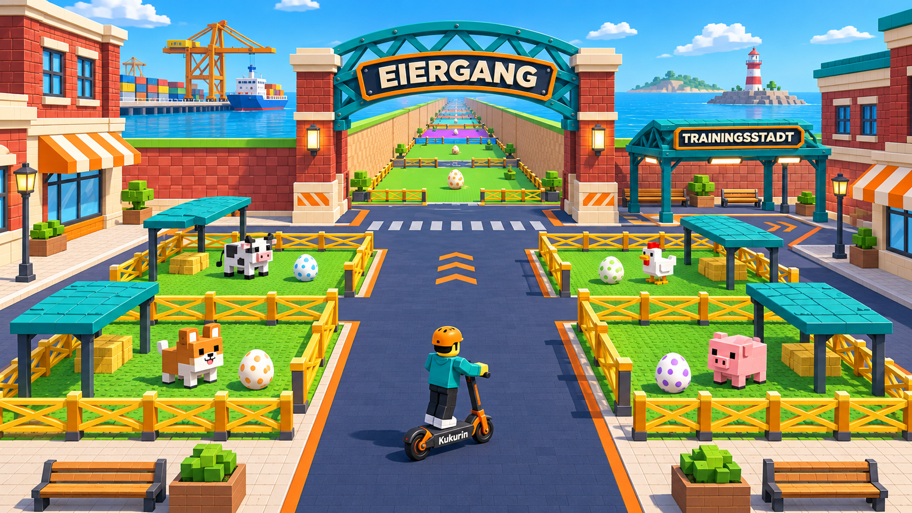
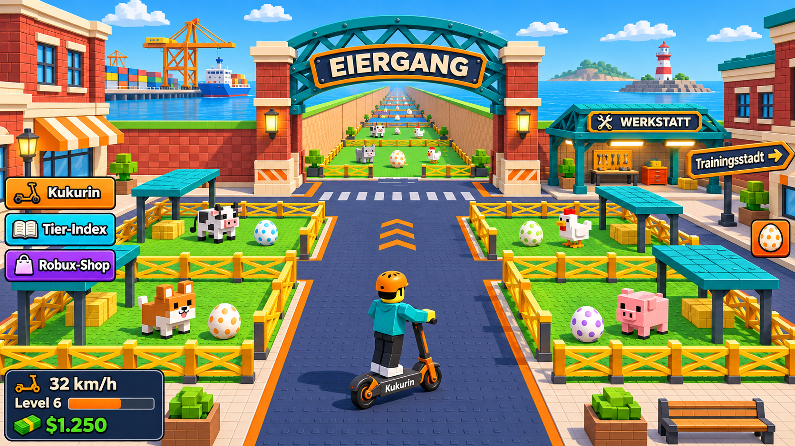
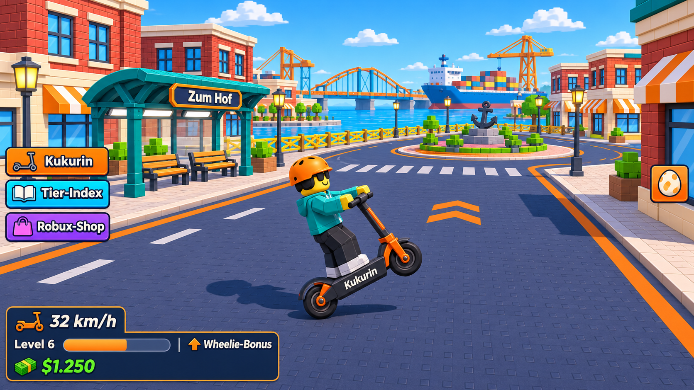
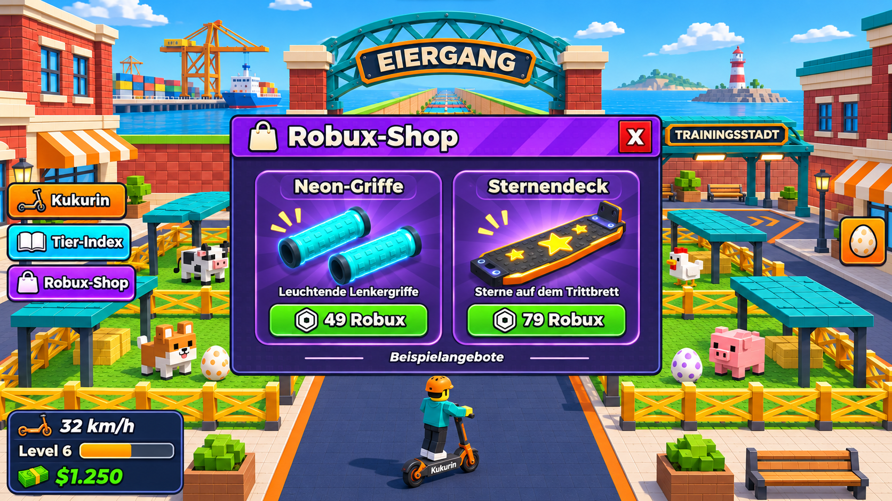
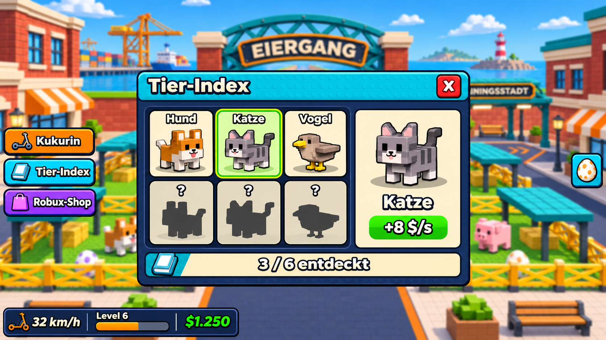
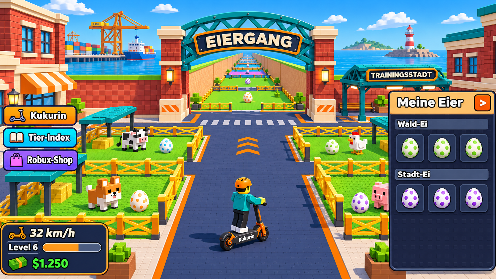
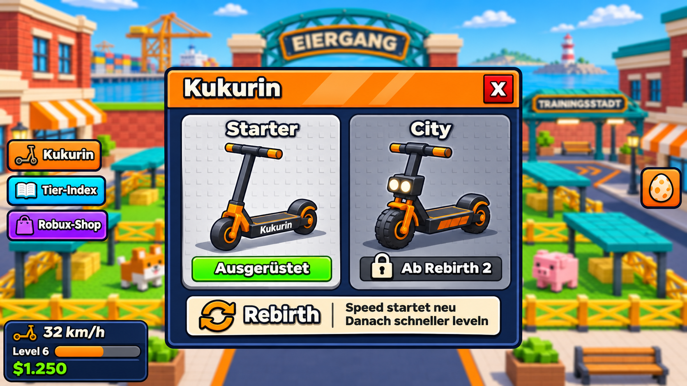
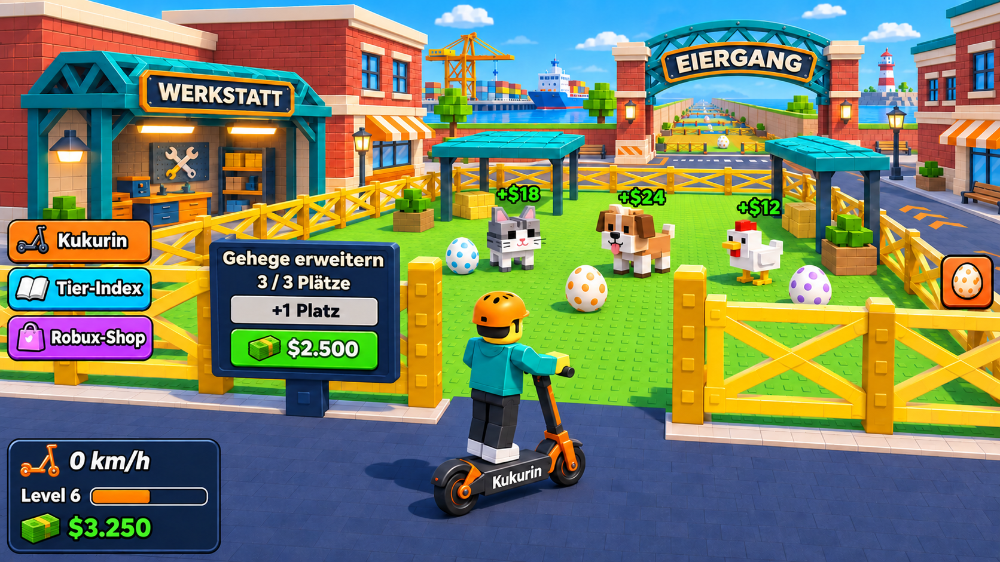
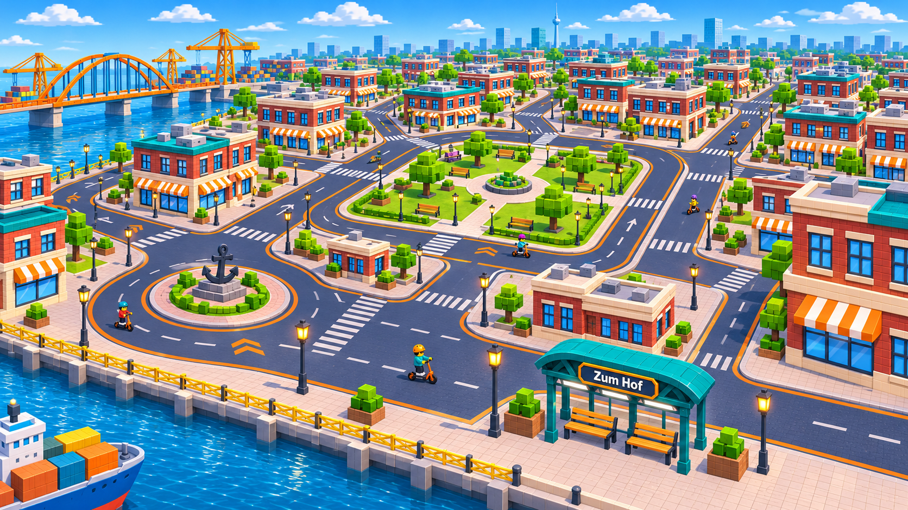

# Kukurin · Map und Spieloberfläche

Neun Bauvorlagen für Claude Code. Für den räumlichen Aufbau zuerst den Hof und seine Sichtachse durch den Eiergang ansehen. Für die Bedienung die Fahransicht mit dem geöffneten Shop vergleichen.

Die Gehege öffnen sich zur Mittelachse. Durch den großen Torbogen sind die Abschnitte der Eierstrecke zu sehen. Rechts am Hof liegt der Zugang zur Trainingsstadt.

| Ansicht | Beim Nachbau beachten |
| --- | --- |
|  | **Fahransicht am Eiergang** Die Fahransicht hält die Mitte frei. Links liegen Kukurin, Tier-Index und Robux-Shop. Das Instrument unten links zeigt Geschwindigkeit, Fahrlevel, Trainingsleiste und Geld. |
|  | **Wheelie in der Trainingsstadt** Das Hinterrad trägt den Kukurin beim Wheelie. Der Hinweis beim Fahrtraining kennzeichnet den zusätzlichen Fortschritt auf dem gefahrenen Abschnitt. In dieser Welt kann der Spieler frei durch die Straßen fahren. |
|  | **Geöffneter Robux-Shop** Das Shopfenster öffnet sich mittig, der Gehegehof bleibt im Hintergrund sichtbar. Jede Karte zeigt einen Artikel, seine Wirkung und einen Preis in Robux. Das X führt zurück zum Spiel. |
|  | **Geöffneter Tier-Index** Das Raster zeigt entdeckte Tiere und unbekannte Einträge. Die Detailfläche zeigt das ausgewählte Tier und seinen Beitrag zum Einkommen. |
|  | **Eierpanel am Gehege** Die Eierliste öffnet sich rechts. Gehege und Spielwelt bleiben während der Verwaltung sichtbar. |
|  | **Kukurin-Übersicht mit Rebirth** Die Modellkarten zeigen den aktiven Kukurin und den Rebirth für das nächste Modell. Der Rebirth setzt Speed zurück und beschleunigt das weitere Leveln. |
|  | **Gehegeausbau aus Spielersicht** Ein Schild am Eingang zeigt Belegung, zusätzliche Plätze und den Preis in Spielgeld. Jedes eingesetzte Tier erhöht das Einkommen. |

**Straßennetz der Trainingsstadt.** Diese Übersicht ergänzt die Wheelie-Ansicht. Mehrere miteinander verbundene Stadtblöcke geben Spielern bei jeder Runde die Wahl zwischen einer neuen Abzweigung und der Strecke zurück zum Hof.

## Angaben für die Umsetzung

Für diese Serie wurde ein Hafenviertel mit Backstein, türkisfarbenen Dächern und gelben Zäunen gewählt. Der Hafen ist ein Gestaltungsvorschlag. Für den Grundriss ist Bild 01 maßgeblich, für die Platzierung der Bedienelemente Bild 02. Die Werkstatt kann neben dem Weg zur Trainingsstadt stehen.

Die Zahl der sichtbaren Gehege, Tierarten, Modellnamen und Beträge sind Bildbeispiele. Die Produkte und Preise im Robux-Shop stehen zur Entscheidung. Das Freischalten eines neuen Kukurin erfolgt beim zugehörigen Rebirth. Im Gehege wird mit Spielgeld bezahlt. Der Wheelie gibt zusätzlichen Trainingsfortschritt pro Strecke. Seine Stärke ist noch offen.

Das Spiel verwendet dieselben Fahrdaten in beiden Welten und zeigt den aktuellen Stand in allen Fenstern an. Die Abbildungen zeigen einzelne Spielsituationen. Das Öffnen oder Schließen eines Menüs löst keinen Kauf aus.

[Spielkonzept](../SPIELKONZEPT.md) · [Originalansichten](../../references/steal-an-egg/screenshots/) · [Bildaufträge und verwendete Vorlagen](PROMPTS.md) · [Dateiprüfsummen](manifest.json)
